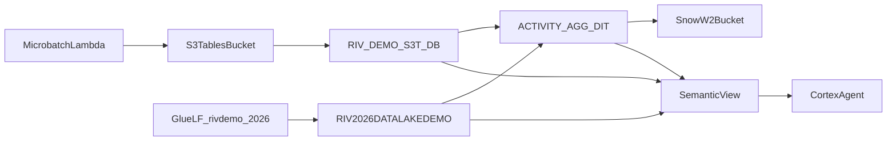

# RIV 2026: Snowflake and AWS data lake demo

A retail sell-through demo that uses Apache Iceberg three ways and joins them in one analytics layer:

| # | Pattern | AWS side | Snowflake side |
|---|---|---|---|
| 1 | Streaming into S3 Tables | Lambda writes 50-row micro-batches every 10 s to S3 table bucket `riv-demo-2026-s3t` | Catalog-linked database `RIV_DEMO_S3T_DB` (read-only) |
| 2 | Glue Data Catalog + Lake Formation | Glue database `rivdemo_2026` (item, location, retailer master data), LF vended credentials | Writable catalog-linked database `RIV2026DATALAKEDEMO` |
| 3 | Snowflake-managed Iceberg | S3 bucket `riv-demo-2026-snow-w2` | Database `RIV2026DL_SNOW` with a dynamic Iceberg table, 1-minute lag, joining 1 + 2 |
| + | Analytics | | Semantic view `RIV_RETAIL_DISTRIBUTION_SV` + Cortex Agent "Retail Distribution Analyst" |



All AWS resources live in the shared sandbox account `484577546576` (us-west-2). You bring your own
Snowflake account (AWS us-west-2 recommended) and connect it through one shared IAM role,
`riv-demo-2026-shared-role`.

## Quick start (CoCo Desktop skill)

The `riv-lakehouse-demo` skill sets up the whole demo in your own Snowflake account. It creates your own S3 bucket and IAM role in the SE Sandbox; no admin is needed.

**Prerequisites:**
- ACCOUNTADMIN in your Snowflake account;
- the AWS CLI with the `sesandbox` profile (the skill can walk you through it);
- Lake Formation admin in the sandbox (all SEs have it);
- `python3`.

**Install:** clone this repo. In CoCo Desktop, open **Agent Settings, then Plugins**, click **+**, choose **Add Local Plugin**, and select the repo root folder. Full instructions, including GitHub import, are in [docs/05_coco_plugin.md](docs/05_coco_plugin.md). Then type `/riv-lakehouse-demo` or ask "set up the RIV lakehouse demo".

The skill:
1. checks you are ACCOUNTADMIN and that the sandbox profile works;
2. asks for your database names (default `RIVDEMO_<USER>_SNOW_DB`, `RIVDEMO_<USER>_GLUE_CLD`, `RIVDEMO_<USER>_S3T_CLD`);
3. creates the AWS bucket, role and Lake Formation grants, and the Snowflake objects;
4. adds the agent to CoWork.

It also starts the micro-batch Lambda safely: it won't start a second run while one is active. Details are in [skills/riv-lakehouse-demo/SKILL.md](skills/riv-lakehouse-demo/SKILL.md), and the demo script is in [skills/riv-lakehouse-demo/references/demo-guide.md](skills/riv-lakehouse-demo/references/demo-guide.md).

For a presenter with no AWS access, the `cld-glue-quick-presenter` skill covers a Glue-only version.

## Quick start (Snowsight, shared role)

| Step | Guide | Scripts |
|---|---|---|
| 0 | Role, warehouse, how trust works | [docs/00_onboarding.md](docs/00_onboarding.md), `sql/00_setup_role_wh.sql` |
| 1 | S3 Tables + streaming Lambda | [docs/01_s3tables.md](docs/01_s3tables.md), `sql/01_s3tables/` |
| 2 | Glue + Lake Formation | [docs/02_glue_lf_cld.md](docs/02_glue_lf_cld.md), `sql/02_glue_lf/` |
| 3 | Snowflake-managed Iceberg | [docs/03_snowflake_managed.md](docs/03_snowflake_managed.md), `sql/03_snow_managed/` |
| 4 | Semantic view + agent | [docs/04_analytics.md](docs/04_analytics.md), `sql/04_analytics/` |
| - | Problems | [docs/troubleshooting.md](docs/troubleshooting.md) |
| - | Install the CoCo Desktop plugin | [docs/05_coco_plugin.md](docs/05_coco_plugin.md) |
| - | Clean up | `sql/99_teardown.sql` |

Fastest path: run the three `01_*` scripts first (catalog integrations and external volume), send all
three ARN / ExternalId pairs to the sandbox admin in one message, then continue once trust is added.

## Repo layout

```
sql/        Snowsight worksheets, run in numeric order
docs/       Step-by-step guides
aws/        Shared IAM role scripts and the micro-batch Lambda (admins only)
skills/     CoCo Desktop skill: per-user setup, demo run and teardown
tests/      Render scripts with other names (prefix or per-user config) and the E2E runbook
```

## Shared data: please be careful

The S3 Tables and Glue tables are shared by everyone using the sandbox. The demo never deletes them,
but the Glue database is writable: do not `DROP` or `DELETE` from `item`, `location` or
`retailer_metadata`. Use your own scratch tables (see `sql/02_glue_lf/03_verify.sql`).
