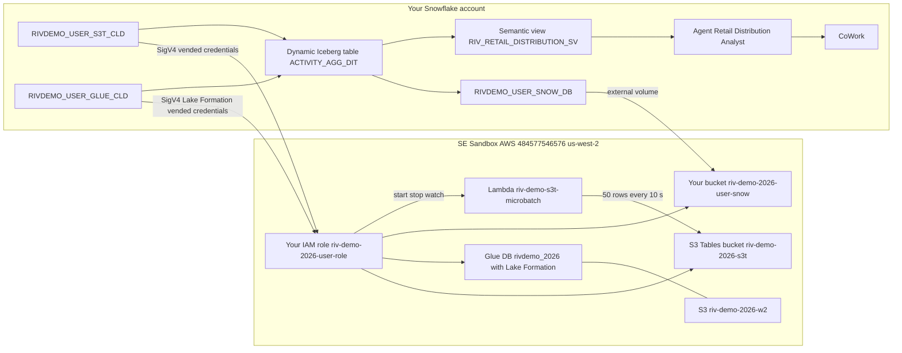

# RIV 2026 lakehouse demo guide

A consumer brand sells apparel and footwear through 12 retail trading partners. Product, store and retailer reference data lives in AWS Glue Iceberg tables. Weekly sell-through and inventory activity streams into Amazon S3 Tables. Snowflake reads both in place, with no copies, through catalog-linked databases. It then aggregates them into a Snowflake-managed dynamic Iceberg table in your own bucket and answers questions through a Cortex Agent in CoWork.

## Architecture



| Pattern | Snowflake object | AWS source | Access |
|---|---|---|---|
| 1. S3 Tables | `RIVDEMO_<USER>_S3T_CLD` (read-only) | `riv-demo-2026-s3t`, namespaces `rawdata` and `rivdemo_ingest` | S3 Tables Iceberg REST, vended credentials |
| 2. Glue + Lake Formation | `RIVDEMO_<USER>_GLUE_CLD` | Glue database `rivdemo_2026` (`item`, `location`, `retailer_metadata`) | Glue Iceberg REST, Lake Formation vended credentials |
| 3. Snowflake-managed | `RIVDEMO_<USER>_SNOW_DB.DYNAMIC_ICEBERG.ACTIVITY_AGG_DIT` | your bucket `riv-demo-2026-<user>-snow` | external volume |

The dynamic Iceberg table joins pattern 1 activity with pattern 2 reference data every minute (target lag 1 minute, incremental refresh). The semantic view covers all three patterns.

## Demo script (about 10 minutes)

1. **Set the scene (Snowsight).** Open the two catalog-linked databases. Show that the tables come from Glue and S3 Tables with no load step. `SHOW ICEBERG TABLES IN DATABASE RIVDEMO_<USER>_GLUE_CLD;` shows `catalog_name` pointing at the Glue integration.
2. **Open CoWork.** Go to https://ai.snowflake.com and pick **Retail Distribution Analyst**. Ask "How fresh is the data?" and note the last load time.
3. **Start the stream.** In CoCo, ask: "start the RIV micro-batch". The skill runs `scripts/lambda_status.sh`, then `scripts/lambda_start.sh`. If someone else's run is active, it offers to wait or watch instead of starting a second one.
4. **Show data arriving.** Rerun the batch query in `sql/01_s3tables/03_verify.sql`. A new `batch_seq` lands about every 10 seconds, and the catalog-linked database syncs every 30 seconds.
5. **Ask again.** After one to two minutes, ask "How fresh is the data?" again. The time has moved forward because the dynamic Iceberg table picked up the new batches.
6. **Business questions.**
   - What are net sales and margin % by department?
   - Which categories are overstocked based on weeks of supply?
   - Which retailers have the most units in transit right now?
   - Which 5 stores have the worst shrink?
   - Show the weekly net sales trend
7. **Open storage.** Show that the dynamic table's Iceberg files are in your own bucket. Run `aws s3 ls --recursive s3://riv-demo-2026-<user>-snow/<user>/dynamic_iceberg/`. Any Iceberg engine could read them.
8. **Stop the stream** if you started it: `scripts/lambda_stop.sh`. A full run ends on its own after about 8 minutes (2,000 rows).

## Lambda commands

```bash
bash scripts/lambda_status.sh               # RUNNING / IDLE, last batch, stop flag
bash scripts/lambda_start.sh                # refuses if RUNNING; 50 rows every 10 s from rowid 1
bash scripts/lambda_start.sh 50 10 201      # resume from rowid 201
bash scripts/lambda_stop.sh                 # stop after the current batch
aws logs tail /aws/lambda/riv-demo-s3t-microbatch --follow --profile riv-demo-deployer --region us-west-2
```

The Lambda scripts run as profile `riv-demo-deployer`, which assumes the shared role `riv-demo-s3t-deployer-role`. `scripts/deployer_access.sh` sets this up once per machine. In CoCo Desktop, just ask: "start the RIV micro-batch", "is the RIV Lambda running?" or "stop the RIV micro-batch". The skill runs the scripts with that profile.

The Lambda and its target table are **shared**:
- Only one run can be active across all presenters.
- Every presenter's S3 Tables catalog-linked database sees every batch.
- Each run replays rows 1 to 2000 with new timestamps, so rows repeat across runs by design.

## Talking points and caveats

- **Zero copy:** catalog-linked databases discover and sync tables automatically; nothing is loaded into Snowflake.
- **Governance stays in AWS:** Lake Formation decides what the Glue integration can read, and Snowflake gets short-lived vended credentials.
- **Open format end to end:** even the Snowflake-managed table is Iceberg in an S3 bucket you own.
- **Brand is mostly UNKNOWN in this data:** use department or category instead.
- **One channel per retailer:** each retailer reports one channel, so channel comparisons are really retailer comparisons.
